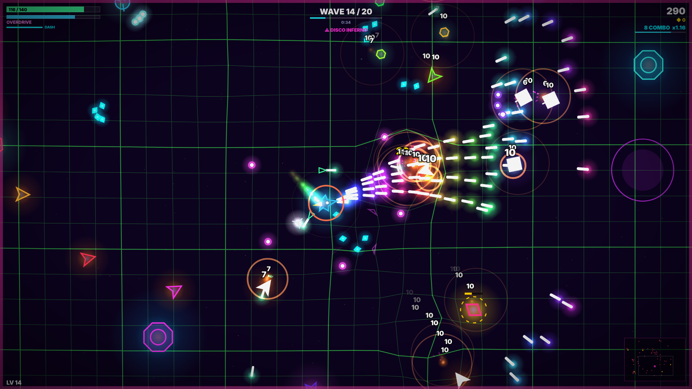

# HYPERCHAOS

**Neon arena roguelite.** Survive 20 waves of escalating madness, stack absurd weapon upgrades into game-breaking builds, and unleash **OVERDRIVE** when the chaos meter fills.



## Features

| | |
|---|---|
| **20-wave campaign** | Four bosses (Hive Queen, Obliterator, Mirrormind, Chaos Engine) with multi-phase attack patterns |
| **Endless mode** | Bosses loop with scaling health. How deep can you go? |
| **Daily Chaos** | A seeded daily run: same ship and same chaos events for every player that day |
| **12 Chaos Events** | Meteor Storm, Mirror World, Singularity, Bullet Hell, Big Mode, Blackout, Disco Inferno... |
| **33 upgrades** | Common to Legendary: orbitals, drones, tesla chains, hydra shells, ricochet, thunder god... |
| **5 ships** | Vector, Razor, Bulwark, Prism, Glitch, each with its own playstyle |
| **Meta progression** | Earn shards to buy permanent upgrades and unlock ships |
| **24 achievements** | With shard rewards |
| **Overdrive** | Invincibility, 2.5x fire rate, slowed time and a screen-clearing shockwave |
| **Juice** | Reactive warp grid, additive neon glow, hit-stop, screen shake, damage numbers |
| **Procedural audio** | Every sound effect *and* the adaptive synthwave soundtrack is synthesized live. No asset files |
| **Every input** | Keyboard + mouse, gamepad (Xbox/PlayStation/Steam Deck) and touch twin-sticks |
| **Accessible settings** | Volume mixing, shake, particles, flashes, CRT filter, auto-fire, FPS counter |
| **Tiny** | The whole web build is about 215 KB, with zero runtime dependencies |

## Play it locally

No build step needed. Either:

- Double-click `index.html`, or
- `npm start` and open <http://localhost:8080>

## Project structure

```
index.html            Page shell + menu markup
css/style.css         Neon UI
src/util.js           Math, seeded RNG, spatial grid, VERSION + STUDIO_NAME
src/save.js           localStorage persistence
src/audio.js          Procedural SFX + step-sequencer soundtrack
src/input.js          Keyboard/mouse, gamepad, touch
src/fx.js             Particles, warp grid, glow sprites
src/data.js           Ships, upgrades, meta shop, achievements, chaos events  <- balance here
src/enemies.js        Enemy roster + AI
src/bosses.js         Bosses
src/player.js         Ship, weapons, orbitals, drones
src/game.js           Main loop, waves, combat, pickups, hazards, rendering
src/hud.js            In-game HUD
src/ui.js             Menus
src/main.js           Boot
electron/             Desktop wrapper (Steam / itch app / direct download)
tools/                Dev server, web zipper, smoke test, store-asset generator
marketing/            Generated cover, capsules and 1920x1080 screenshots
```

## Building for sale

### 1. Web build (itch.io, Newgrounds, CrazyGames, Poki, GameDistribution)

```bash
npm run build:web        # -> dist/hyperchaos-web.zip
```

For a free demo that ends after wave 5 (Endless and Daily locked), run `npm run build:demo`, which writes `dist/hyperchaos-demo-web.zip`.

Upload the zip to itch.io as **"This file will be played in the browser"**. Set the viewport to 1280x720 and tick *Fullscreen button* and *Mobile friendly*.

### 2. Desktop builds (Steam, itch.io downloadable, your own store)

```bash
npm install
npm run desktop          # try it in a window
npm run build:win        # -> release/  NSIS installer + portable .exe   (run on Windows)
npm run build:mac        # -> release/  .dmg                             (run on macOS)
npm run build:linux      # -> release/  .AppImage
```

The desktop build starts fullscreen. F11 or Alt+Enter toggles it, and a **QUIT** button appears in the main menu.

### 3. Regenerate store art after changes

```bash
npm i -D playwright && npx playwright install chromium   # once
npm run marketing        # cover, Steam capsules, screenshots, build/icon.png
npm test                 # automated QA run through every event and boss
```

## Where to sell & suggested pricing

| Store | Notes | Suggested price |
|---|---|---|
| **itch.io** | Instant, free to list, you choose the revenue share. Offer the free web demo (`npm run build:demo`) and sell the desktop download. | $3.99 - $4.99 |
| **Steam** | $100 Steam Direct fee per game. Use the Electron build. Wishlists before launch are key. | $4.99 |
| **Web portals** (CrazyGames, Poki, GameDistribution) | Ad revenue share rather than sales. Upload the web zip. | Free + ads |
| **Mobile** | Wrap with Capacitor or Cordova; touch controls are built in. | $1.99 or free + IAP |

`STORE_PAGE.md` has ready-to-paste store copy, tags and a feature list.

## Customising

- **Studio name:** `STUDIO_NAME` in `src/util.js` (shown on the credits screen).
- **Version:** `VERSION` in `src/util.js` and `version` in `package.json`.
- **App ID / copyright:** the `build` section of `package.json`.
- **Balance:** almost everything lives in `src/data.js` (upgrades, ships, meta costs). Wave scaling is in `startWave()` in `src/game.js`, and boss HP is in `src/bosses.js`.
- **Before you launch,** do a trademark search on the name "HYPERCHAOS" in your target markets.

## License

Proprietary. Copyright (c) 2026 ammarkarimi. All rights reserved. See `LICENSE`.
