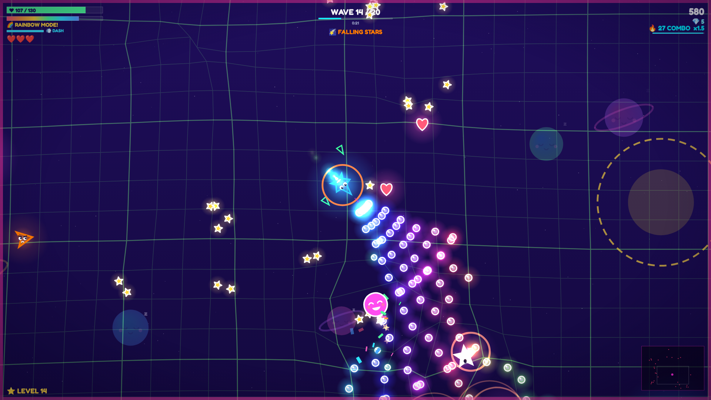

# HYPERCHAOS: Super Silly Space Adventure

**A bright, cute, non-violent space game that small kids love, with real depth for grown-ups.** Fly a happy little rocket, blow sparkle bubbles, and cheer up the Grumpies: grumpy space monsters that turn into smiling faces and float away in confetti.



## Made for kids

| | |
|---|---|
| **Easy for little hands** | Shooting and aiming are automatic. Kids just steer with the arrows, a stick or a finger drag |
| **Gentle by default** | **Easy** gives 3 lives, extra health, slower and softer Grumpies and shorter waves. **Normal** and **Hard** are there to grow into |
| **Non-violent** | Enemies get *cheered up*, not destroyed: googly-eyed Grumpies turn happy and float away |
| **Pre-reader friendly** | Emoji icons on every button, card and sticker. Short, simple words |
| **Lots of praise** | "NICE!", "AWESOME!", "SUPERSTAR!" pop-ups, confetti, a cheering voice and 1-3 star ratings. A game never ends with "Game Over", only "Good try!" |
| **Collecting** | 24 stickers in a Sticker Book, 5 cute rockets, 9 shop upgrades |
| **Parent features** | Break reminder (15/30/60 min), "grown-ups only" maths gate before erasing progress, no ads, no purchases, no tracking, fully offline |
| **Comfort settings** | Screen shake, flashes, confetti amount, voice, music and sound volume |

## Game features

- **20-wave adventure**, **Forever Mode** and a seeded **Daily Surprise**
- **4 Big Grumpy bosses**: Queen Buzz, Robo Grump, Copycat Crystal and King Grumpus
- **12 surprise events**: Disco Party, Giant Mode, Teeny Tiny, Treasure Time, Piñata Party, Space Whirlpool...
- **33 super powers**: Double Shot, Robot Buddy, Spinning Star, Smart Bubbles, Confetti Pop, Thunder Buddy...
- **Rainbow Mode**: fill the rainbow bar for invincible, super-fast bubble blasting
- A reactive warp-grid playground, sleepy cartoon planets, and a happy chiptune soundtrack. **Every sound and picture is generated live**, with no asset files apart from one small font
- Keyboard + mouse, gamepad (Xbox/PlayStation/Steam Deck) and touch
- Under 300 KB for the whole web build

## Play it locally

No build step needed. Either:

- Double-click `index.html`, or
- `npm start` and open <http://localhost:8080>

## Project structure

```
index.html            Page shell + menu markup
css/style.css         Candy-coloured UI
assets/fonts/         Fredoka font (SIL Open Font License, see OFL.txt)
src/util.js           Math, seeded RNG, spatial grid, VERSION + STUDIO_NAME
src/save.js           localStorage persistence
src/audio.js          Procedural SFX + step-sequencer soundtrack
src/input.js          Keyboard/mouse, gamepad, touch
src/fx.js             Particles, warp grid, glow sprites
src/data.js           Difficulty levels, rockets, powers, shop, stickers, events  <- balance here
src/enemies.js        Enemy roster + AI
src/bosses.js         Bosses
src/player.js         Ship, weapons, orbitals, drones
src/game.js           Main loop, waves, combat, pickups, hazards, rendering
src/hud.js            In-game HUD
src/ui.js             Menus
src/pwa.js            Offline cache + INSTALL APP button (web only)
src/main.js           Boot
privacy.html          Privacy policy page
assets/icons/         App icons for phones, tablets and browsers
electron/             Desktop wrapper (Steam / itch app / direct download)
tools/                Dev server, web zipper, site builder, smoke test, store-asset generator
vercel.json           Website hosting config
.github/workflows/    Automatic desktop builds -> GitHub Release
marketing/            Generated cover, capsules and 1920x1080 screenshots
```

## Building for sale

### 1. Web build (itch.io, Newgrounds, CrazyGames, Poki, GameDistribution)

```bash
npm run build:web        # -> dist/hyperchaos-web.zip
```

For a free demo that ends after wave 5 (Endless and Daily locked), run `npm run build:demo`, which writes `dist/hyperchaos-demo-web.zip`.

Upload the zip to itch.io as **"This file will be played in the browser"**. Set the viewport to 1280x720 and tick *Fullscreen button* and *Mobile friendly*.

### 2. Website and installable app (Vercel)

The game is hosted on Vercel, which redeploys it automatically on every push. `vercel.json` runs `npm run build:site`, which copies only the game files into `site/` and adds `sw.js`, an offline cache.

Players can install it like a real app:
- **Android / Chrome / Edge:** tap **📲 INSTALL APP** in the main menu, or *Install app* in the browser menu
- **iPhone / iPad:** Safari → Share → **Add to Home Screen**

Once installed it opens fullscreen with its own icon and plays **offline**. The privacy policy page that kids' app stores ask for is at `/privacy.html`.

```bash
npm run build:site        # -> site/  (full game)
npm run build:site:demo   # -> site/  (free demo instead)
node tools/serve.js site  # preview it at http://localhost:8080
```

To publish only the free demo on the website (and sell the full game elsewhere), add the environment variable `HYPERCHAOS_DEMO=1` in the Vercel project settings and redeploy.

### 3. Desktop apps (Steam, itch.io downloadable, your own store)

```bash
npm install
npm run desktop          # try it in a window
npm run build:win        # -> release/  NSIS installer + portable .exe   (run on Windows)
npm run build:mac        # -> release/  .dmg                             (run on macOS)
npm run build:linux      # -> release/  .AppImage
```

**Automatic builds:** the *Build desktop apps* GitHub Actions workflow builds Windows (installer + portable), macOS (universal .dmg) and Linux (.AppImage) on GitHub's machines and attaches them to a GitHub Release. Run it from the **Actions** tab, or push a version tag:

```bash
npm version 1.1.0        # bumps package.json and creates the v1.1.0 tag
git push --follow-tags
```

The builds are not code-signed, so Windows SmartScreen and macOS Gatekeeper show a warning the first time (*More info → Run anyway* on Windows; *right-click → Open* on Mac). Before selling desktop copies, add signing certificates (see the launch checklist in `STORE_PAGE.md`).

The desktop build starts fullscreen. F11 or Alt+Enter toggles it, and a **QUIT** button appears in the main menu.

### 4. Regenerate store art after changes

```bash
npm i -D playwright && npx playwright install chromium   # once
npm run marketing        # cover, Steam capsules, screenshots, build/icon.png
npm test                 # automated QA run through every event and boss
```

## Where to sell & suggested pricing

| Store | Notes | Suggested price |
|---|---|---|
| **itch.io** | Instant, free to list, you choose the revenue share. Tag it "kids" and "family friendly". Offer the free web demo (`npm run build:demo`) and sell the desktop download. | $3.99 - $4.99 |
| **Steam** | $100 Steam Direct fee per game. Use the Electron build. Wishlists before launch are key. | $4.99 |
| **Web portals** (CrazyGames, Poki, GameDistribution) | Ad revenue share rather than sales. Upload the web zip. | Free + ads |
| **Mobile / tablets** | Wrap with Capacitor or Cordova; touch controls are built in. Kids' categories (Apple "Kids", Google "Teacher Approved") need a privacy policy and no third-party ads or tracking, which this game already meets. | $2.99 premium (best for kids' apps) |

`STORE_PAGE.md` has ready-to-paste store copy, tags and a feature list.

## Customising

- **Studio name:** `STUDIO_NAME` in `src/util.js` (shown on the credits screen).
- **Version:** `VERSION` in `src/util.js` and `version` in `package.json`.
- **App ID / copyright:** the `build` section of `package.json`.
- **Difficulty:** the `DIFFICULTY` table at the top of `src/data.js` (lives, health, enemy speed and damage, wave length).
- **Balance:** almost everything lives in `src/data.js` (powers, rockets, shop costs). Wave scaling is in `startWave()` in `src/game.js`, and boss HP is in `src/bosses.js`.
- **Before you launch,** do a trademark search on the name "HYPERCHAOS" in your target markets.

## License

Proprietary. Copyright (c) 2026 ammarkarimi. All rights reserved. See `LICENSE`.
