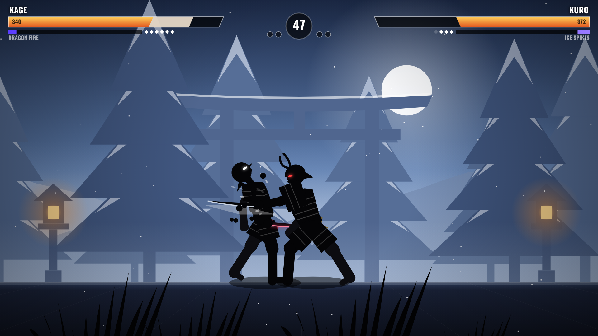

# UMBRA: Duel of Shadows

**A silhouette sword-fighting game.** Six shadow warriors, real weapon combat, and a forge full of gear to buy and upgrade. There are no levels to grind through: you choose your rival, from a nervous dojo apprentice to the Last Sword Saint, and the stronger the rival, the bigger the reward.



**Play now:** https://umbra-duel-of-shadows.vercel.app. It installs as an app on phones and tablets and works offline. Privacy policy: https://umbra-duel-of-shadows.vercel.app/privacy.html

## Features

- **Frame-based combat.** Every move has startup, active and recovery frames, plus hitstop, counter hits, juggles, knockdowns and guard breaks.
- **Deep but simple controls.** Attack, kick and heavy attack, each with direction variations (lunge, rising launcher, low slash, side kick, sweep), plus 3-hit combos, special cancels, aerial attacks, throws, magic and rolls.
- **Real blocking.** Hold back to block. Low attacks must be blocked crouching and jump attacks standing, heavy attacks break any guard, and the Ronin can parry at the last moment.
- **6 playable fighters**, each with a trait: Double Jump, Perfect Parry, Inner Focus, Iron Body, Killer Instinct or Spellweaver.
- **5 weapon classes** that change how you fight: fists, dual blades, swords, polearms and heavy weapons.
- **The Forge:** 43 items across weapons, armor, helmets, ranged weapons and magic, each upgradable to ★★★★★. Rarer gear adds perks: Burning, Frost, Venom, Lifesteal, Thunder, Keen Edge, Thorns, Recovery and Meditation.
- **7 magic types:** Ki Blast, Dragon Fire, Ice Spikes, Heaven's Wrath lightning, Earth Shatter, Shadow Step and Soul Drain.
- **14 computer rivals** across 7 difficulty tiers (Novice → Legend). Each has its own fighter, gear, fighting style and AI skill (reaction time, blocking, reading, combos, punishing).
- **Fair AI.** Bots see the fight through a reaction delay and press the same virtual buttons a player does.
- **Modes:** Duel (vs any rival), local 2-player Versus, and Training with a switchable dummy.
- **Gets new players fighting fast:** a brand-new player lands in an 8-step interactive tutorial fight (move, combo, kick, block, guard break, air attack, magic, knockout). Prompts match the player's device (keyboard, gamepad or touch), and the reward is 150 coins plus a one-tap **NEXT DUEL**.
- **Reasons to come back:** a daily gift on a 7-day streak (coins every day, gems on days 3, 6 and 7), and win streaks that pay up to +50% coins.
- **Easy to follow:** combo callouts (NICE! GREAT COMBO! SAVAGE!), a coloured ring and a YOU marker under your fighter, and a "turn your phone sideways" hint.
- **6 painted arenas** with parallax and weather: Moonlit Bamboo, Sunset Temple, Misty Bridge, Volcano Forge, Snow Shrine and Crimson Gate.
- **Procedural soundtrack** (taiko, koto, shamisen, flute) and sound effects, with no audio files.
- 18 honors, an optional announcer voice, damage numbers and screen-shake settings.
- **Plays everywhere:** keyboard, 2 players on one keyboard, gamepads, and touch with a virtual stick and buttons. On phones and tablets it installs as an app and works offline.

## Controls

| Action | Keyboard | Gamepad |
|---|---|---|
| Move / jump / crouch | `A` `D` / `W` / `S` or arrows | Left stick / D-pad, `A` jumps |
| Attack (weapon) | `J` | `X` |
| Kick | `K` | `Y` |
| Heavy (breaks guard) | `U` | `LB` |
| Throw | `L` | `RB` |
| Magic (meter full) | `I` | `RT` |
| Roll | `O` / `Shift` | `B` |
| Block | Hold **back** | Hold **back** |
| Pause | `Esc` / `P` | `Start` |

**Moves:** Forward+Attack is a lunge, Back+Attack a rising launcher, Down+Attack a low slash, Forward+Kick a side kick and Down+Kick a sweep. In the air, Attack or Kick is an overhead. Attack ×3 is a combo, and Attack, Attack, Kick ends one with a kick. On hit you can cancel into Back+Attack, Forward+Kick or Down+Kick.

**Versus (same keyboard):** Player 1 uses `WASD` + `J K L U I O`. Player 2 uses the arrows + `N M , . /` and `Right Shift` (or numpad `1`–`5`, `0`). Each gamepad takes a side.

## Progression without levels

Every rival is open from the start, and the title screen's **NEXT DUEL** button always points at the next rival to beat. Their **power** rating is shown next to yours (green = weaker, yellow = even, red = stronger). Wins pay coins (more for higher tiers), the first win against each rival pays gems, and EXPERT and above rivals always drop a few gems. Spend coins in the **Forge** and unlock fighters in the **Dojo**. Losing still pays 35% of the reward, so you are never stuck.

## Run it

```bash
npm start                 # http://localhost:8080
npm run desktop           # desktop window (after npm install)
```

Or just open `index.html` in a browser.

## Building for sale

```bash
npm run build:web         # dist/umbra-web.zip        (itch.io, CrazyGames, Poki, Newgrounds...)
npm run build:demo        # dist/umbra-demo-web.zip   (free demo: first 3 tiers, 2 fighters, tier 1-2 gear)
npm run build:site        # site/                     (static website, installable + offline)
npm run build:win         # release/  installer + portable .exe   (on Windows)
npm run build:mac         # release/  universal .dmg              (on macOS)
npm run build:linux       # release/  .AppImage
npm run marketing         # icons, screenshots, cover + Steam capsules
```

**Automatic desktop builds:** the *Build UMBRA desktop apps* GitHub Actions workflow builds Windows, macOS and Linux apps on GitHub's machines and attaches them to a GitHub Release. Run it from the **Actions** tab, or push a tag such as `umbra-v1.0.0`.

**Website:** live at https://umbra-duel-of-shadows.vercel.app (Vercel project `umbra-duel-of-shadows`, Root Directory `umbra`). It redeploys on every push. Set `UMBRA_DEMO=1` in the project's environment variables to publish the free demo instead of the full game.

## Quality and balance tools

```bash
npm test                              # browser smoke test: real keyboard input, every rival, versus, training, touch
node tools/sim.js 20 hard normal      # headless bot-vs-bot duels between two AI tiers
node tools/ladder.js                  # checks that each rival beats the one before it
node tools/classes.js                 # weapon class balance vs the katana
node tools/progression.js hard 800    # economy: how long a player takes to reach each tier
```

Balance at release:
- Each rival beats the previous one in the ladder; the two rivals within a tier are close.
- Every weapon class wins 35–63% of bot fights against the katana. At high skill the fast weapons (fists, dual blades) have the edge; at lower skill reach (polearms) helps more.
- A HARD-skill bot starting from a fresh save beats its first HARD rival after about 40 minutes, its first MASTER after about 4 hours and a LEGEND after about 5.5 hours. These times count fighting only.
- A pure button-masher (never blocks) with starter gear beats every NOVICE and EASY rival and splits with the first NORMAL one, but loses almost every fight from Tetsu (NORMAL) upward. Beginners get early wins, and the climb needs real skill.

## Project structure

```
index.html            Page shell and menus
css/style.css         Interface styling
src/util.js           Helpers, VERSION, STUDIO_NAME, DEMO_MODE
src/data.js           Fighters, weapon classes, items, perks, rivals, tiers, arenas, honors  <- balance here
src/moves.js          Poses and frame data for every move, shared combat rules
src/render.js         Skeleton kinematics, silhouette + equipment drawing, cloth chains
src/fighter.js        Fighter state machine, physics, combos, statuses, power rating
src/ai.js             Computer opponent brain and training dummy
src/game.js           Match: rounds, hit resolution, blocking/parry, projectiles, magic, camera
src/stage.js          Procedural parallax arenas and weather
src/fx.js             Particles and floating text
src/hud.js            Health, meter, timer, combo HUD
src/audio.js          Procedural sound effects, music sequencer, announcer
src/input.js          Keyboard (1-2 players), gamepads, touch
src/ui.js             Menus, previews, forge, dojo, rivals, results, honors
src/main.js           Loop, match lifecycle, rewards
src/pwa.js            Offline cache + install button (web only)
electron/             Desktop wrapper
tools/                Server, builders, simulators, smoke test, marketing generator
marketing/            Store art and screenshots
```

## License

Proprietary. © 2026 ammarkarimi. See `LICENSE`. Fonts: Cinzel and Oswald (SIL Open Font License, see `assets/fonts/OFL.txt`).
